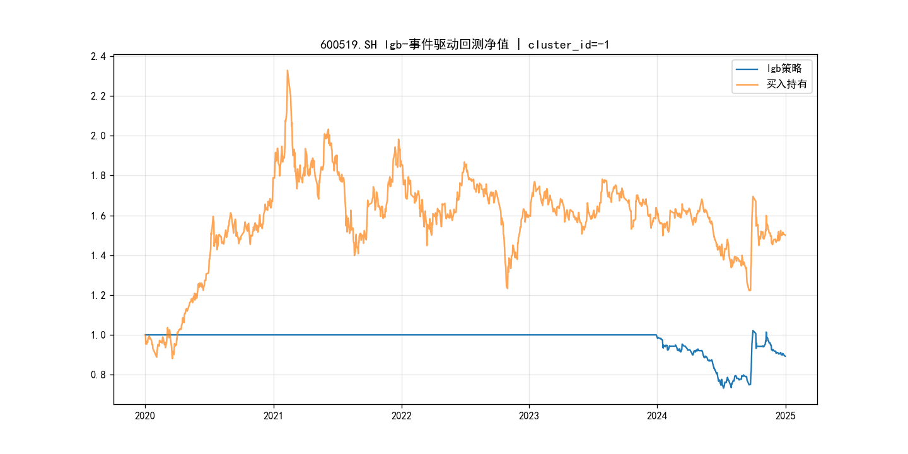
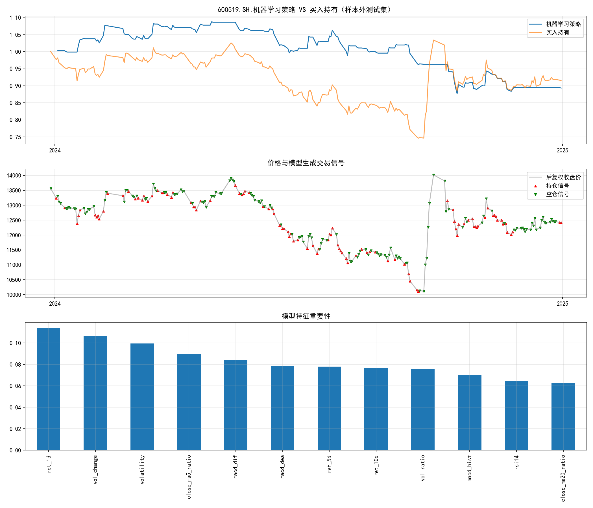
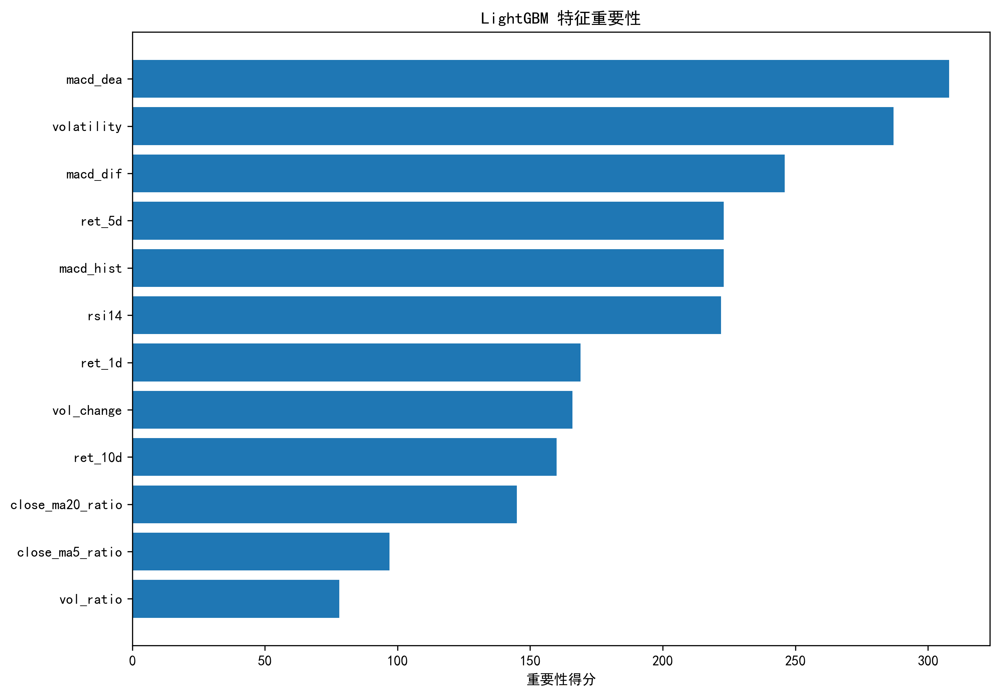
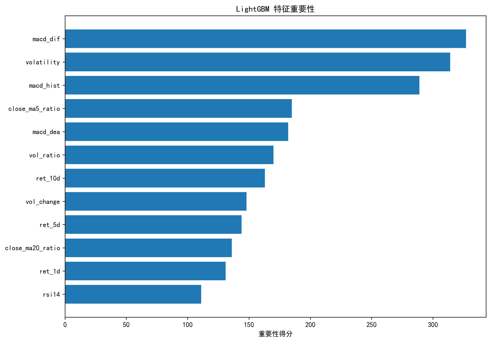
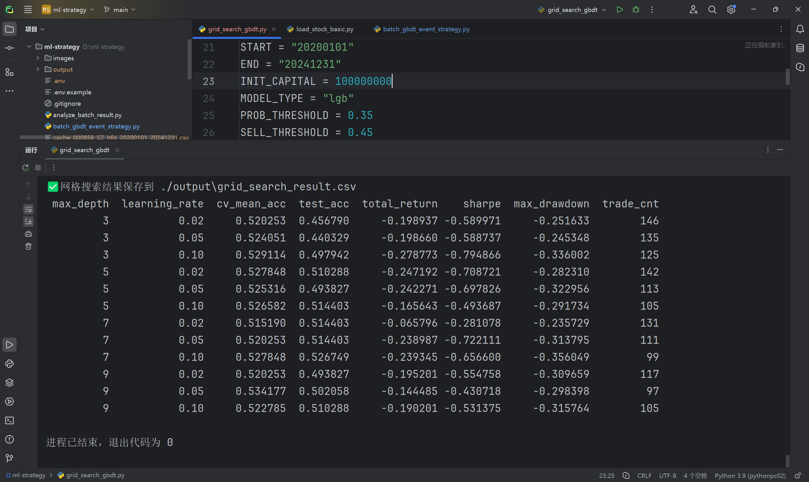

# A股量化回测项目（均线策略+机器学习拓展）
> ⚠️免责声明：本项目仅用于编程与量化学习演示，**不构成任何投资建议**。历史回测结果不能代表未来实际收益。

本项目实现一套完整A股机器学习量化回测框架，包含两套回测实现：
1. **事件驱动回测**：严格模拟实盘订单生命周期，支持手续费、印花税、滑点、A股100股最小交易单位，用于严谨策略评估；
2. **向量化回测**：运算速度快，适合快速调参粗筛，不模拟真实撮合细节。

模型支持 LightGBM / XGBoost / 随机森林，基于量价技术指标做涨跌分类预测；使用时序交叉验证避免时间泄露。

## 📊 回测效果可视化
标的：600519.SH 贵州茅台，LGB事件驱动量化策略
### 1. 全周期净值对比（2020–2024）
蓝色：LGB机器学习策略净值；橙色：买入持有基准

> 说明：策略偏风控导向，在震荡下行阶段主动空仓，牺牲部分收益换取回撤控制，净值走势更加平稳。
### 2. 样本外净值、交易信号与模型特征重要性
上图：样本外测试集策略净值与基准对比
中图：K线叠加买卖信号，直观展示模型开仓、平仓时机
下图：LightGBM特征重要性，解释模型依赖量价、均线、波动率因子生成信号


## 🧪 批量多股票回测实验（LightGBM）
> 实验目的：验证策略是否仅对单只标的（茅台）有效，排查单标的过拟合风险
> 回测区间：2020‑01‑01 ~ 2024‑12‑31
> 测试标的：600519.SH 贵州茅台、000858.SZ 五粮液
> 配置：LightGBM模型，TimeSeriesSplit时序5折交叉验证，事件驱动严谨回测引擎

### 多标的回测指标对比
| stock_code | model_type | cv_mean_acc | test_acc | total_return |
| ---- | ---- | ---- | ---- | ---- |
| 600519.SH | lgb | 0.5253 | 0.4938 | -0.2423 |
| 000858.SZ | lgb | 0.5329 | 0.5556 | -0.2109 |

### 📝实验结论
1. 两只标的的样本外预测准确率仅略高于50%随机水平，技术因子对涨跌的预测能力偏弱；
2. 在2020‑2024震荡下行行情中，两只股票回测总收益均为负，说明**策略存在较强的行情环境依赖性，熊市、震荡市容易失效**；
3. 五粮液样本外准确率略高于茅台，但依旧无法实现正向收益；证明策略不是单纯拟合茅台单只股票，但整体盈利能力仍存在明显短板；
4. 后续迭代优化方向：改进涨跌标签逻辑、增加事件驱动内核止损风控、扩充因子特征库、超参数网格搜索调参。

### 多标的特征重要性



## 🧪 网格搜索调参实验
> 实验目的：遍历树深度`max_depth`、学习率`learning_rate`，观察模型容量变化，直观演示机器学习过拟合现象
> 回测区间：2020‑01‑01 ~ 2024‑12‑31
> 测试标的：600519.SH 贵州茅台
> 配置：LightGBM模型，时序5折TimeSeriesSplit交叉验证；事件驱动回测；初始资金1亿元，买入概率阈值0.35
> 遍历参数：
> - `max_depth: [3,5,7,9]`：树深度，控制模型容量，数值越大拟合能力越强，更容易记住训练集噪声
> - `learning_rate: [0.02,0.05,0.10]`：学习率，迭代步长，步长过大容易震荡不稳定



### 📝实验结论
1. 随着树深度`max_depth`增大，时序交叉验证准确率`cv_mean_acc`逐步上升，模型对训练集拟合效果变好；但**测试集准确率`test_acc`提升有限**，回测收益、夏普比率没有同步提升，出现典型过拟合：模型学习到训练集噪声，泛化能力没有同步增强。
2. 学习率设置偏大（0.10）时，策略更容易出现更大的最大回撤，回测稳定性下降。
3. 本项目默认超参`max_depth=5, learning_rate=0.05`，在该数据集实现训练拟合与泛化能力之间的权衡。
4. ⚠️实验踩坑记录：A股最小交易单位为1手(100股)，**初始资金不足时，即使模型发出买入信号，也会因为资金门槛无法成交，出现trade_cnt=0零交易现象**；本实验使用1亿初始资金规避资金门槛带来的成交抑制问题。
5. ⚠️风险提示：该机器学习策略在此回测区间整体无法获得正向收益；本实验仅用于演示建模调参与过拟合分析，**不构成任何投资建议**。

> 备选标签拓展思考：项目中还实现了备选标签逻辑（未来5日最大涨幅大于3%标记上涨样本），可以过滤小幅价格噪声；但该构造方式会造成正样本数量稀少，模型输出上涨概率整体偏低，极易出现零交易；说明**标签构造对策略行为的影响往往大于模型超参数调优**。

### 两个回测引擎区别
1. **event_backtest.py【事件驱动回测（严谨）】**
- 完整模拟A股：1手(100股)最小交易单位、手续费、印花税、滑点；
- 事件驱动架构：MarketEvent / SignalEvent / OrderEvent / FillEvent；
- 适合策略严谨评估，真实贴近实盘下单逻辑。

2. **ml_strategy.py【向量化快速回测（仅粗筛）】**
- 向量化批量计算，运行速度快；
- ⚠️重要限制：**没有模拟1手交易规则，不处理订单撮合，仅用于快速因子筛选、实验；不能作为严谨回测结果**。
> 项目机器学习正式评估统一使用 `batch_gbdt_event_strategy.py`（底层复用event_backtest事件驱动内核）。

## 项目文件结构

```
├── event_backtest.py           # 事件驱动底层回测内核，双均线策略示例
├── batch_gbdt_event_strategy.py# 批量多股票 GBDT (LGB/XGB) + 事件驱动回测
├── grid_search_gbdt.py         # 网格搜索调参实验脚本，遍历 max_depth、learning_rate 观察过拟合
├── analyze_batch_result.py     # 批量回测结果分析脚本，读取汇总 csv，生成 Markdown 对比表格
├── ml_strategy.py              # 随机森林向量化快速回测（粗筛工具）
├── db_utils.py                 # MySQL 数据库读写工具类
├── load_stock_basic.py         # 股票基础信息初始化脚本
├── init_db.sql                 # MySQL 建表 SQL 脚本
├── requirements.txt            # Python 依赖清单
├── .gitignore                  # Git 忽略配置
├── .env.example                # 环境配置模板（提交至 Git）
├── .env                        # 本地私有配置，复制.env.example 生成，不上传 Git
└── images/                     # README 展示图片，提交到仓库
```

### 文件说明
### 文件说明
- `event_backtest.py`：事件驱动回测内核，模拟真实下单、成交、持仓逻辑；支持单只标的回测。
- `batch_gbdt_event_strategy.py`：批量回测脚本，调用事件驱动内核，支持LGB、XGBoost模型；支持K‑Means股票聚类实验，支持Tushare / AKShare双数据源切换。
- `grid_search_gbdt.py`：网格搜索调参实验脚本，遍历树深度、学习率，输出超参组合回测指标csv，用于观察过拟合现象。
- `analyze_batch_result.py`：批量回测后分析工具，读取output目录下批量汇总csv，自动生成Markdown格式指标对比表格，方便写入项目文档。
- `ml_strategy.py`：向量化快速回测，**不模拟A股100手最小交易单位**，仅用于快速实验；严谨评估请使用事件驱动版本。
- `db_utils.py`：MySQL数据库工具类，封装所有表的插入、查询操作；解决`np.nan`入库报错，处理事务提交、回滚、连接安全关闭，规避MySQL空闲断开问题。
- `load_stock_basic.py`：手动写入股票基础信息，绕过Tushare stock_basic接口限流。
- `init_db.sql`：MySQL数据库建表语句，包含行情、因子、回测结果全套表结构。


## 环境准备
### 1. Python版本
推荐 Python `3.9 ~ 3.11`

### 2. 安装依赖
```bash
pip install -r requirements.txt
